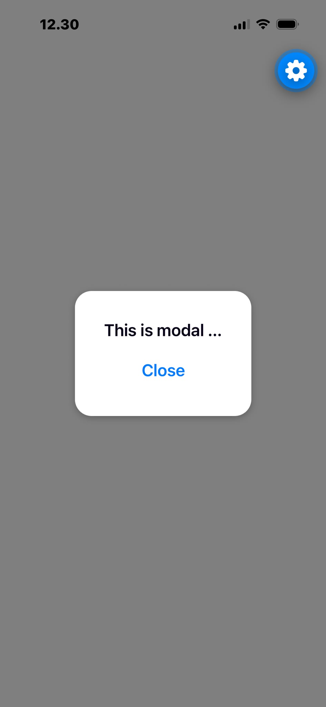

# Modal Demo

## Main code explanations

### 1. State Variables

```tsx
const [modalVisible, setModalVisible] = useState<boolean>(false);
```

- **`useState<boolean>(false)`**: Creates a state variable with a boolean type and sets its initial value to `false`.
- **`modalVisible`**: Holds the current value of the state.
- **`setModalVisible`**: The function used to update the state value.

### 2. Pressable Component

```tsx
<Pressable onPress={() => setModalVisible(true)}>
```

- **`Pressable`**: A core React Native component that detects various stages of press interactions on its children.
- **`onPress`**: An event handler that triggers when the user taps the component.

### 3. Modal Component

```tsx
<Modal
  visible={modalVisible}
  onRequestClose={() => setModalVisible(false)}
>
```

- **`Modal`**: A component used to display content above the enclosing view.
- **`visible`**: A boolean prop that determines whether the modal is currently shown or hidden.
- **`onRequestClose`**: A callback that triggers when the user presses the hardware back button on Android devices.


## Screenshot


